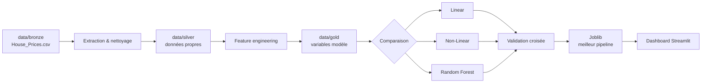

# ESTATIA

### House prices, turned into a decision.

Estatia transforme un catalogue immobilier brut en estimation exploitable : nettoyage, enrichissement, comparaison de modèles et interface de prédiction. Le projet est pensé comme une petite chaîne de production ML, de la donnée `Bronze` au prix estimé affiché dans Streamlit.

<p align="center">
	<strong>BRONZE</strong> &nbsp;→&nbsp; <strong>SILVER</strong> &nbsp;→&nbsp; <strong>GOLD</strong> &nbsp;→&nbsp; <strong>MODEL</strong> &nbsp;→&nbsp; <strong>ESTIMATION</strong>
</p>

---

## Le projet en un regard

| Couche | Rôle | Sortie |
|:--|:--|:--|
| `Bronze` | Données originales des ventes | `House_Prices.csv` |
| `Silver` | Données nettoyées et contrôlées | `House_Prices_Silver.csv` |
| `Gold` | Variables prêtes pour l'apprentissage | `House_Prices_Gold.csv` |
| `Model` | Meilleur pipeline sélectionné | `house_price_model.joblib` |
| `Dashboard` | Formulaire et visualisation du prix | Streamlit |



## Ce qui se passe sous le capot

- Nettoyage des doublons, valeurs manquantes et observations aberrantes.
- Création des données `Silver` puis `Gold` avec des variables exploitables.
- Encodage des variables catégorielles et préparation des variables numériques dans des pipelines scikit-learn.
- Comparaison de trois familles de modèles : régression linéaire, modèle non linéaire et Random Forest.
- Recherche d'hyperparamètres par validation croisée, puis sauvegarde du meilleur pipeline.
- Estimation interactive et positionnement du prix prédit sur la distribution du marché.

## Démarrage express

### 1. Installer

Python 3.11 est recommandé.

```bash
python -m venv .venv
source .venv/bin/activate
pip install streamlit joblib matplotlib numpy pandas rich scikit-learn seaborn
```

### 2. Construire les données et le modèle

Depuis la racine du projet :

```bash
python main.py
```

La commande lit les données Bronze, écrit les couches Silver et Gold, évalue les modèles et génère `models/house_price_model.joblib`.

### 3. Ouvrir l'application

```bash
streamlit run dashboard/app.py
```

Puis ouvrir [localhost:8501](http://localhost:8501). Renseignez les caractéristiques du logement et lancez l'estimation.

## Option Docker

Pour lancer l'expérience complète dans un conteneur :

```bash
docker compose up --build
```

Le port local peut être changé sans modifier le projet :

```bash
APP_PORT=8502 docker compose up --build
```

Arrêt du service :

```bash
docker compose down
```

## Architecture

```text
.
├── data/
│   ├── bronze/       Source et dictionnaire des données
│   ├── silver/       Données nettoyées
│   └── gold/         Données enrichies pour le modèle
├── src/              Extraction, nettoyage et chargement
├── features/         Création des variables
├── models/           Pipelines Linear, Non-Linear et Tree
├── evaluation/       Comparaison et optimisation
├── dashboard/        Interface Streamlit
├── notebooks/        Exploration et visualisations
└── main.py           Orchestration du pipeline
```

## Artefacts principaux

| Fichier | Utilité |
|:--|:--|
| `data/bronze/House_Prices.csv` | Source immobilière |
| `data/silver/House_Prices_Silver.csv` | Données nettoyées |
| `data/gold/House_Prices_Gold.csv` | Données préparées pour l'entraînement |
| `models/house_price_model.joblib` | Pipeline final chargé par Streamlit |
| `data/bronze/data_description.txt` | Description des variables |

## Stack

`Python` · `pandas` · `scikit-learn` · `Streamlit` · `Joblib` · `Matplotlib` · `Seaborn` · `Docker Compose`

## Note de reproductibilité

Le modèle chargé par le dashboard doit être généré avant son lancement. Pour repartir d'un état propre, supprimez les artefacts `Silver`, `Gold` et le fichier Joblib, puis relancez `python main.py`.